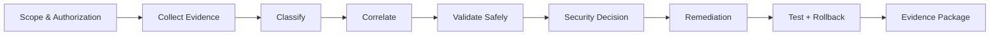

<div align="center">

# Gabriel Barbosa — Cybersecurity Engineer

### Cloud Security · Incident Response · DevSecOps · AI Security

**Evidence-first security engineering with reproducible labs and production-safe decision making.**


[Português (Brasil)](README.pt-BR.md) · [Portfolio Index](PORTFOLIO_INDEX.md) · [Engineering Evidence Map](docs/ENGINEERING_EVIDENCE_MAP.md) · [Learning Path](LEARNING_PATH.md) · [Methodology](methodology/evidence-first-production-safe.md) · [Security & Confidentiality](SECURITY.md)

</div>

---

## About

I am a **Cybersecurity Engineer at FoundLab**, focused on cloud-native security, incident response, secure delivery pipelines and AI security.

My work is organized around traceable evidence: define scope and authorization, collect telemetry, separate facts from hypotheses, validate safely, implement proportionate controls, and verify remediation.

**Professional-affiliation boundary:** FoundLab is referenced only as professional context. The public portfolio contains synthetic laboratories and anonymized summaries of real security-engineering assessments. No private project or client is identified, and no internal architecture, proprietary source, raw telemetry, credentials, operational identifiers or actionable private findings are reproduced. Such summaries are not assertions about any employer's deployed security posture.

## Author

**Gabriel Barbosa — Cybersecurity Engineer**  
**FoundLab — Cybersecurity Engineer**

**Selected credentials & training:** Offensive Cybersecurity postgraduate studies · Extreme Hacking / Ethical Hacking · AI Red Teaming · Google Cybersecurity Professional · Threat Intelligence Analyst · AI Security & Governance · AWS Security · Digital Forensics.

**Links:** [GitHub Profile](https://github.com/gabrielbdss) · [LinkedIn](https://www.linkedin.com/in/gabriel-b-souza-silva-255397316)

## Portfolio snapshot

| Evidence | Current repository |
|---|---:|
| Security engineering case studies | **8** |
| Hands-on synthetic labs | **5** |
| Runnable local security tools | **3** |
| Merge-gate regression tests | **17** |
| Incident-triage regression tests | **14** |
| Cloud-security regression tests (least privilege + serverless) | **18** |
| Runnable Python unit tests (excluding supplemental adversarial runners) | **80** |
| External runtime dependencies for local Python tools | **0** |

These numbers describe inspectable artifacts in this repository, not private employer work. CI executes 17 merge-gate, 14 incident-triage, 18 cloud-security and 31 AI-authorization unittest cases, plus 9 + 20 supplemental adversarial cases. The source-only dependency-triage exercise does not claim an executable scanner.

**Additional executable evidence:** [Cloud Incident Triage](labs/01-cloud-incident-triage/README.md) correlates fictional JSONL telemetry; [Cloud Least Privilege](labs/02-cloud-least-privilege/README.md) compares synthetic declared grants with workload requirements. Both use local-only Python scripts and tests, with no cloud credentials.

## Reproduce a result

A reviewer can run the DevSecOps Merge Gate locally with no cloud account or external dependency:

```bash
cd labs/04-devsecops-merge-gate
python3 gate.py evidence/positive.json
echo $?   # expected: 0

python3 gate.py evidence/negative.json
echo $?   # expected: 1

python3 gate.py evidence/not-applicable.json
echo $?   # expected: 0

python3 gate.py evidence/unknown.json
echo $?   # expected: 1

python3 -m unittest -v test_gate.py
```

Expected policy behavior: **PASS, FAIL, PASS, FAIL**. `UNKNOWN` fails closed. The `lab-v2` evaluator also rejects missing required lanes, invalid policy versions and unauthorized `N/A` exemptions; the 17-test suite covers these cases. The CI workflow runs the suites on pushes and PRs. The synthetic evaluator is separate from GitHub's **active branch ruleset**, whose failed-check blocking behavior was verified publicly in [PR #4](https://github.com/gabrielbdss/cybersecurity-engineering-portfolio/pull/4).

See the [validation record](labs/04-devsecops-merge-gate/VALIDATION.md) and [source](labs/04-devsecops-merge-gate/gate.py).

## Engineering focus

| Domain | What I demonstrate |
|---|---|
| **Cloud Security** | IAM, workload identity, least privilege, key management, audit logging, serverless security |
| **Incident Response** | triage, timeline reconstruction, telemetry correlation, evidence preservation, containment reasoning |
| **DevSecOps** | CI/CD security gates, dependency risk, branch governance, fail-closed controls, regression validation |
| **AI Security** | AI red teaming, prompt injection, agent/tool trust boundaries, authorization and excessive-agency analysis |
| **Security Governance** | security baselines, threat models, playbooks, evidence packages and remediation planning |

## How I work



**OBSERVED** — directly present in collected evidence.  
**VERIFIED** — independently corroborated.  
**INFERRED** — supported indirectly, but not directly demonstrated.  
**UNVERIFIED** — not demonstrated with available evidence.

## Selected professional work · Sanitized case studies

The assessments below stem from **work carried out in real organizational environments**. Published reports use reconstructed or generalized examples and **do not expose private operational evidence**.

| Focus | Professional work | Public evidence |
|---|---|---|
| **Cloud Security / AI Governance** | Read-only audit of AI service usage, observability, build/runtime traceability and migration decision risks | [Cloud & AI Infrastructure Security Audit — reconstructed report](case-studies/07-cloud-ai-continuity-audit/README.md) |
| **Incident Response** | Investigation of security-relevant cloud events, evidence correlation and bounded conclusions | [Cloud-Native Incident Response — sanitized professional case](case-studies/01-cloud-native-incident-response/README.md) |
| **Application Security** | Real source-based review using SAST, dependency assessment and manual authorization analysis | [Project Lumen — anonymized assessment](case-studies/04-ai-security-red-teaming/PROJECT_LUMEN_ASSESSMENT.md) |

**Evidence boundary:** The work was real; illustrative datasets, systems and diagrams in reconstructed reports are **fictional**. No employer sign-off, production fix or broad security assurance is implied.

## Featured case studies

### 01 · Cloud-Native Incident Response
**Professional investigation, sanitized public reconstruction.** Evidence preservation, timeline reconstruction, telemetry correlation, competing hypotheses and proportional containment.

[Read the case study →](case-studies/01-cloud-native-incident-response/README.md) · [Sanitized professional report (PDF)](case-studies/01-cloud-native-incident-response/Cloud_Native_Incident_Response_Public_Portfolio.pdf)

### 02 · Cloud Security Baseline & Least Privilege
Effective access, workload identity, cryptographic boundaries, data permissions and remediation with validation and rollback.

[Read the case study →](case-studies/02-cloud-security-baseline/README.md)

### 03 · Deterministic DevSecOps Merge Gate
Deterministic CI/CD security decisions, bounded states, negative testing and fail-closed governance. The separate [public branch protection validation](case-studies/03-devsecops-merge-gate/BRANCH_PROTECTION_VALIDATION.md) includes a real GitHub Actions failure and an unmerged blocked PR from this portfolio.

[Read the case study →](case-studies/03-devsecops-merge-gate/README.md)

### 04 · AI Security & Red Teaming
Prompt injection, excessive agency, retrieval boundaries and tool authorization. A [separate anonymized AppSec assessment](case-studies/04-ai-security-red-teaming/PROJECT_LUMEN_ASSESSMENT.md) documents real Semgrep, Trivy and manual code-review work without exposing the private target.

[Read the case study →](case-studies/04-ai-security-red-teaming/README.md)

### 05 · Security Incident Response Playbook
Evidence preservation, escalation, proportional containment, recovery validation and tabletop exercises.

[Read the playbook →](case-studies/05-incident-response-playbook/README.md)

### 06 · Dependency Vulnerability Triage
Dependency presence, advisory applicability, reachability reasoning and remediation validation without overstating exploitability.

[Read the case study →](case-studies/06-dependency-vulnerability-triage/README.md)

### 07 · Cloud & AI Infrastructure Security Audit
**Professional read-only security assessment, with fully fictional public examples.** Evidence reconciliation, model-consumer attribution limits, build/runtime traceability, observability and safe migration governance.

[Read the case study →](case-studies/07-cloud-ai-continuity-audit/README.md) · [View reconstructed 11-section report →](case-studies/07-cloud-ai-continuity-audit/PUBLIC_REPORT.md)

### 08 · Operation Cymbal: Cold Room — Investigative CTF
**Google Cloud Security Community × Hack The Box (October 2026).** Platform-recorded completion: **3/3 scenarios, 18/18 flags**. A read-only, simulated investigation covering endpoint, identity, cloud, threat hunting and AI-security telemetry. The public case study intentionally omits flags, solution routes, indicators and raw evidence while disclosure permission remains unverified. Conversational AI was used to support reasoning and documentation; participation is **not an official Google Cloud certification or an employer assessment**.

[Read the spoiler-free case study →](case-studies/08-operation-cymbal-cold-room/README.md) · [Publication controls →](case-studies/08-operation-cymbal-cold-room/DISCLOSURE.md)

## Hands-on security labs

| Lab | Demonstrates | Artifacts |
|---|---|---|
| [01 · Cloud Incident Triage](labs/01-cloud-incident-triage/README.md) | evidence-driven incident analysis | Python analyzer, 14 tests, synthetic telemetry |
| [02 · Cloud Least Privilege](labs/02-cloud-least-privilege/README.md) | synthetic grants vs. declared needs | Python analyzer, 7 tests, remediation plan |
| [03 · AI Tool Authorization](labs/03-ai-tool-authorization/README.md) | independent authorization boundary | adversarial test vector and policy evidence |
| [04 · DevSecOps Merge Gate](labs/04-devsecops-merge-gate/README.md) | deterministic fail-closed CI logic | runnable Python evaluator, fixtures and regression tests |
| [05 · Dependency Triage](labs/05-dependency-triage/README.md) | vulnerability reconciliation | scanner, dependency-path and reachability evidence |

## Security assurance workflows

This public portfolio uses **GitHub-managed CodeQL Default Setup** (already active), a new **Publication Gate**, and a **read-only weekly security summary**, alongside Gitleaks, link validation and regression CI. **Dependency Review is enabled as a PR workflow** after the repository owner activated Dependency graph; its validation result must be checked on the activation PR. The publication check is also embedded in the existing merge-gate validation job.

[Review controls, limits, and validation evidence](docs/SECURITY_ASSURANCE.md) · [Actions](https://github.com/gabrielbdss/cybersecurity-engineering-portfolio/actions) · [Publication policy](SECURITY.md)

## Core engineering principles

- **Evidence before mutation.**
- **Production is evidence, not a laboratory.**
- **Claims require evidence.**
- **Least privilege by default.**
- **Severity and confidence are separate dimensions.**
- **Unknown is an acceptable conclusion.**
- **Remediation requires validation and rollback.**
- **Model or agent output is not authorization.**

## Repository map

```text
.
├── .github/workflows/ # Automated portfolio validation
├── case-studies/      # Security engineering cases + disclosure-safe CTF overview
├── labs/              # Reproducible synthetic exercises
├── methodology/       # Evidence First / Production Safe
├── templates/         # Reusable security documentation
├── PORTFOLIO_INDEX.md # Role-oriented navigation
├── GLOSSARY.md        # Shared security terminology
└── SECURITY.md        # Publication & confidentiality policy
```

## Confidentiality by design

The public portfolio may identify an authorized professional affiliation, but it does **not** publish private projects, client identities, production identifiers, credentials, raw operational logs, internal tickets, proprietary source code, non-public architecture or unresolved private findings.

Public implementations are **synthetic or controlled**; selected written assessments instead summarize **real work performed** at a non-identifying level. Neither category reproduces a private employer system or independently proves its production security state.

See [SECURITY.md](SECURITY.md) for the publication standard.

## Explore

For a shorter route through the material, use the [Portfolio Index](PORTFOLIO_INDEX.md). For terminology, see the [Security Engineering Glossary](GLOSSARY.md). Technical corrections and constructive review are welcome under [CONTRIBUTING.md](CONTRIBUTING.md).

---

<div align="center">

**Gabriel Barbosa · Cybersecurity Engineer**  
**FoundLab**

Cloud Security · Incident Response · DevSecOps · AI Security

</div>
