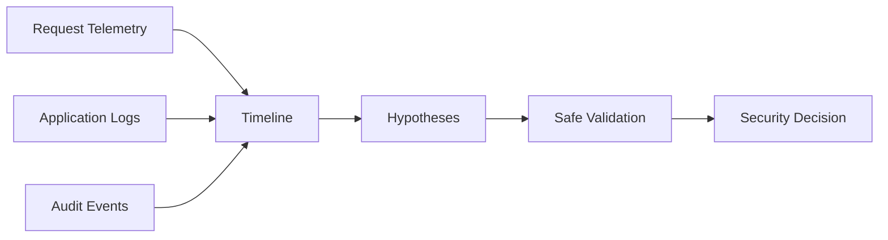

# Case Study 01 — Cloud-Native Incident Response

> **Sanitized reference case.** Identifiers and operational evidence are generalized or synthetic; this is not an internal incident report.

## Publication-ready PDF case study

[**Cloud-Native Incident Response — Sanitized Public Portfolio Edition (PDF)**](Cloud_Native_Incident_Response_Public_Portfolio.pdf)

Eight-page, author-sanitized public edition covering scope, evidence classification, relative timeline, fail-closed behavior, control-plane correlation, findings and limitations. Professional affiliation is mentioned by author-reported permission. The PDF does **not** assert an Alex Bolson signature or independent publication review.

[Public release boundary and publication notes](PUBLICATION_SCOPE.md). This is a professional methodology case presented with generic/synthetic operational details; no employer production configuration, raw logs or unreleased findings are represented.

## Scenario

A cloud-hosted API records an unusual request close to an application failure. The objective is to determine what the evidence supports without treating unfamiliar activity as proof of compromise.

## Investigation model

## Evidence matrix

| Evidence | State | Interpretation |
|---|---|---|
| unusual request exists | OBSERVED | event occurred |
| authorization denial | VERIFIED | protected action was denied in supplied evidence |
| correlated application failure | OBSERVED | error occurred near the event |
| credential compromise | UNVERIFIED | not demonstrated |
| data exfiltration | UNVERIFIED | not demonstrated |

## Investigation sequence

Preserve telemetry; normalize timestamps; correlate identifiers; separate observations from hypotheses; search for privilege, credential and data-access evidence; choose the least invasive validation; contain only when evidence and impact justify it.

## Result

An unusual request and correlated security/application events can be demonstrated. **Compromise or exfiltration cannot be claimed without additional evidence.**

## Engineering lesson

**Unknown is acceptable. Unsupported certainty is not.**

## Confidentiality

FoundLab is identified only as the author's publicly authorized professional affiliation. No employer private-project or client identity, real endpoint, operational IP, private ticket, production identifier or raw private log is included.
